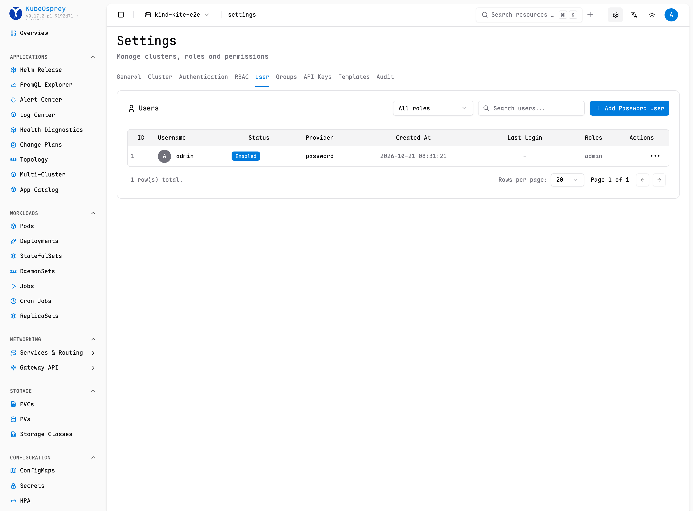

# User Management

KubeOsprey supports multiple user management methods, combining OAuth with local password users, and working with the RBAC permission system to achieve flexible access control.

## User Types

- **OAuth Users**: Login through third-party identity providers (such as GitHub, OIDC, etc.).

For how to configure OAuth, see [OAuth Configuration Guide](./oauth-setup)

- **Password Users**: Login through username and password. Password users can enable authenticator app MFA and register passkeys for passwordless login.
- **API Keys**: Used for scripts, CI/CD, or external systems calling KubeOsprey APIs. See [API Authentication](../api/authentication).

## User Management

Users with the **admin** role can access the settings entry in the upper right corner of the page to enter the user and permission management interface.

In this interface, you can:

- View all current users and their role information
- Add new users (only password users are supported)
- Disable or delete accounts that are no longer needed
- Modify user role assignments to achieve permission adjustments

## Forced Password Change

Accounts created by an administrator and passwords reset by an administrator are flagged for a forced password change. When such a user signs in, the console only shows the password-change page; every other API returns `403 password_change_required` until the password has been changed. Completing the change clears the flag automatically.

## Password Policy

Administrators can configure a password policy in **Settings → General**:

- Password validity period in days (`0` disables expiration)
- Minimum password length (default `8`)
- Complexity requirements: uppercase letters, lowercase letters, digits, and special characters
- Number of previous passwords that cannot be reused

The policy applies to every password set through the console, including administrator-created users, password resets, and self-service changes. When a password expires, login is refused until an administrator resets the password.

## Account Security

MFA and passkey login are enabled by default and can be managed by admins in **Settings -> Authentication**.

Password users can manage their own security settings from the account settings dialog:

- Enable MFA with a TOTP authenticator app
- Add or delete passkeys
- Use passkeys to sign in when passkey login is enabled

MFA and passkeys are available only for password users. OAuth and LDAP users should use the security policies from their identity provider.

## Best Practices

- Recommend prioritizing OAuth users to achieve unified identity management
- Password users are suitable for special or temporary scenarios
- Enable MFA or passkeys for password users
- Regularly review user lists and role assignments to ensure minimal permissions
- Disable unused accounts to reduce security risks

For permission assignment, refer to [RBAC Permission Management](./rbac-config)
