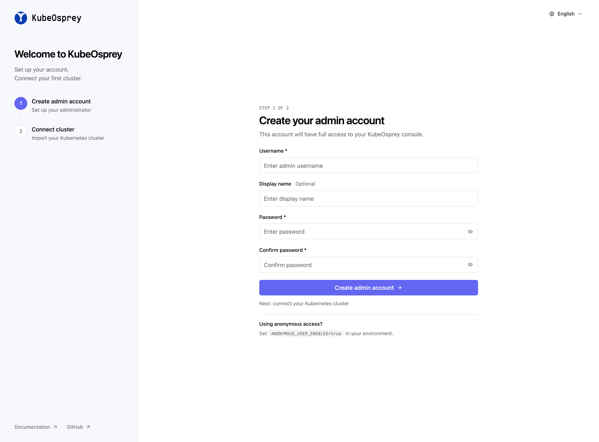
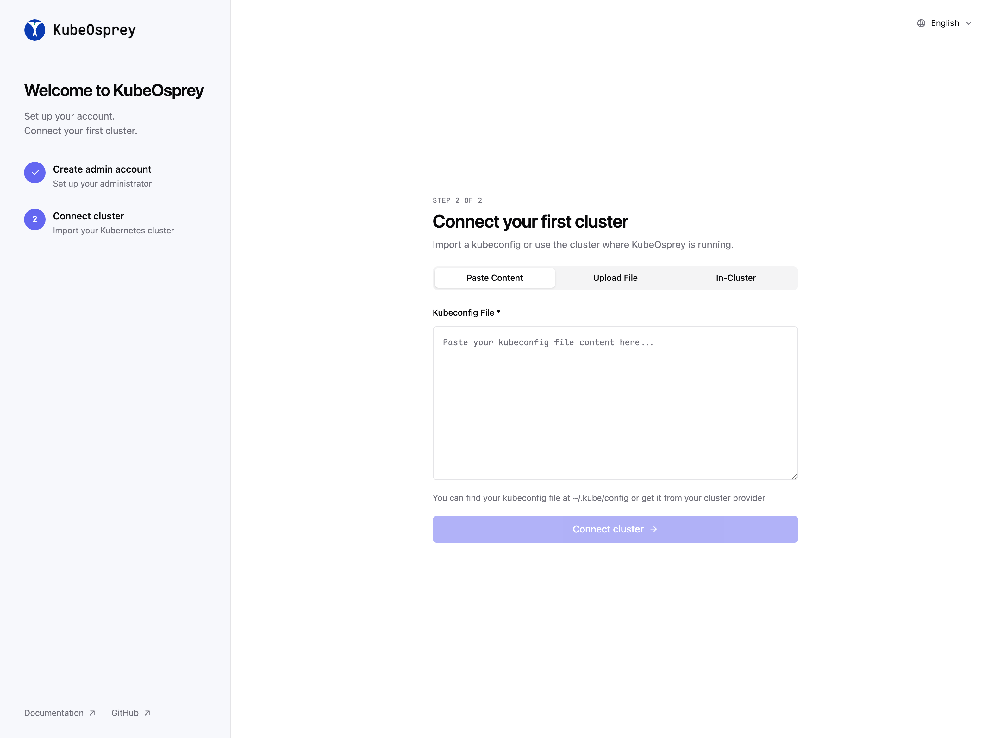

# Installation Guide

This guide provides detailed instructions for installing KubeOsprey in a Kubernetes environment.

## Prerequisites

- `kubectl` with cluster administrator privileges
- Helm v4, or Helm v3.8+ for OCI chart installation
- MySQL/PostgreSQL database, or local storage for sqlite

## Installation Methods

### Method 1: Helm Chart (Recommended)

Using Helm provides flexibility for configuration and upgrades:

Install from OCI registry:

```bash
helm install kube-osprey oci://ghcr.io/fadewalk/charts/kite -n kube-osprey-system --create-namespace --set fullnameOverride=kube-osprey
```

The `fullnameOverride` keeps every deployed resource named `kube-osprey` (the chart itself is still published under its upstream-compatible name `kite`).

Or pin a chart version for reproducible installs:

```bash
helm install kube-osprey oci://ghcr.io/fadewalk/charts/kite --version 0.18.0 -n kube-osprey-system --create-namespace --set fullnameOverride=kube-osprey
```

#### Custom Installation

You can adjust installation parameters by customizing the values file:

For complete configuration, refer to [Chart Values](../config/chart-values).

Install with custom values:

```bash
helm install kube-osprey oci://ghcr.io/fadewalk/charts/kite -n kube-osprey-system -f values.yaml --set fullnameOverride=kube-osprey
```

### Method 2: YAML Manifest

For quick deployment, you can directly apply the official installation YAML:

::: warning
This method is not suitable for production environments, as it does not include any configuration related to persistence. You need to manually mount the persistence volume and set the environment variable `DB_DSN=/data/db.sqlite` to ensure that data is not lost. Alternatively, you can use an external database.

see [Persistence Issues](../faq#persistence-issues) for more details.
:::

```bash
kubectl apply -f https://raw.githubusercontent.com/fadewalk/kube-osprey/main/deploy/install.yaml
```

This method will install KubeOsprey with default configuration. For advanced customization, it's recommended to use the Helm Chart.

## Accessing KubeOsprey

### Port Forwarding (Testing Environment)

During testing, you can quickly access KubeOsprey through port forwarding:

```bash
kubectl port-forward -n kube-osprey-system svc/kube-osprey 8080:8080
```

### LoadBalancer Service

If the cluster supports LoadBalancer, you can directly expose the KubeOsprey service:

```bash
kubectl patch svc kube-osprey -n kube-osprey-system -p '{"spec": {"type": "LoadBalancer"}}'
```

Get the assigned IP:

```bash
kubectl get svc kube-osprey -n kube-osprey-system
```

### Ingress (Recommended for Production)

For production environments, it's recommended to expose KubeOsprey through an Ingress controller with TLS enabled:

::: warning
KubeOsprey's log and web terminal features require websocket support.
Some Ingress controllers may require additional configuration to handle websockets correctly.
:::

```yaml
apiVersion: networking.k8s.io/v1
kind: Ingress
metadata:
  name: kube-osprey
  namespace: kube-osprey-system
spec:
  ingressClassName: nginx
  rules:
    - host: kube-osprey.example.com
      http:
        paths:
          - path: /
            pathType: Prefix
            backend:
              service:
                name: kube-osprey
                port:
                  number: 8080
  tls:
    - hosts:
        - kube-osprey.example.com
      secretName: kube-osprey-tls
```

## Serving under a subpath (basePath)

If you want to serve KubeOsprey under a subpath (for example `https://example.com/kube-osprey`), use the Helm chart `basePath` value.

How to set it:

- In `values.yaml`:

```yaml
basePath: "/kube-osprey"
```

- Or with Helm CLI:

```fish
helm install kube-osprey oci://ghcr.io/fadewalk/charts/kite -n kube-osprey-system --create-namespace --set fullnameOverride=kube-osprey --set basePath="/kube-osprey"
```

Important notes:

- Ingress configuration: make sure your Ingress `paths` match the subpath and use a matching pathType (e.g., `Prefix`). Example:

```yaml
ingress:
  enabled: true
  hosts:
    - host: kube-osprey.example.com
      paths:
        - path: /kube-osprey
          pathType: Prefix
```

- OAuth / redirects: if you enable OAuth (or any external redirect flows), update the redirect URLs in your OAuth provider to include the base path, e.g. `https://kube-osprey.example.com/kube-osprey/oauth/callback`.
- Environment overrides: if you provide environment variables via `extraEnvs` or an existing secret, ensure `KITE_BASE` is set consistently with the `basePath` value (otherwise behavior may differ).

## Verifying Installation

After installation, you can access the dashboard to verify that KubeOsprey is deployed successfully. The expected interface is as follows:

::: tip
If you need to configure KubeOsprey through environment variables, please refer to [Environment Variables](../config/env).
:::





You can complete cluster setup according to the page prompts.

### Quick Setup with In-Cluster Mode

For the simplest setup, select **`in-cluster`** as the cluster type. This option automatically uses the service account credentials that KubeOsprey is running with inside the cluster, requiring no additional configuration:

- **No kubeconfig needed**: KubeOsprey will use its own service account to access the Kubernetes API
- **Automatic authentication**: Works out of the box with the default RBAC permissions
- **Ideal for single-cluster deployments**: Perfect when KubeOsprey is managing the same cluster it's running in

This is the recommended option for getting started quickly, especially in development or when KubeOsprey only needs to manage its own cluster.

## Uninstalling KubeOsprey

### Helm Uninstall

```bash
helm uninstall kube-osprey -n kube-osprey-system
```

### YAML Uninstall

```bash
kubectl delete -f https://raw.githubusercontent.com/fadewalk/kube-osprey/main/deploy/install.yaml
```

## Next Steps

After KubeOsprey installation is complete, you can continue with:

- [Adding Users](../config/user-management)
- [Configuring RBAC](../config/rbac-config)
- [Configuring OAuth Authentication](../config/oauth-setup)
- [Setting up Prometheus Monitoring](../config/prometheus-setup)
